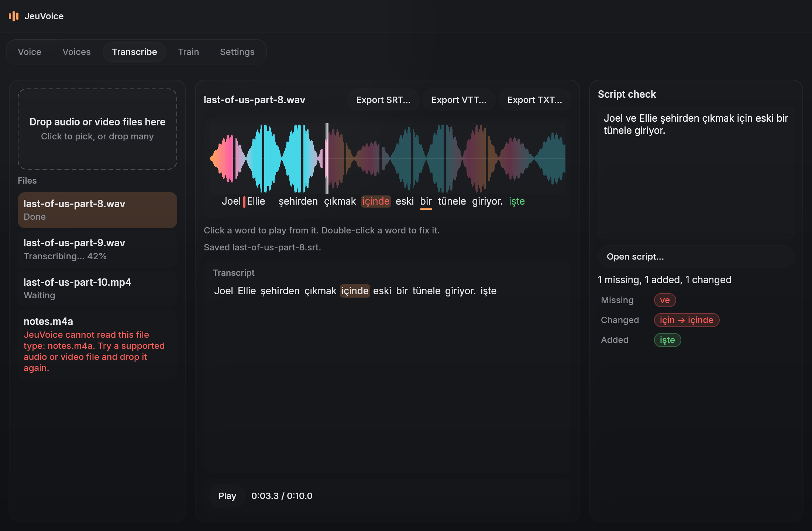
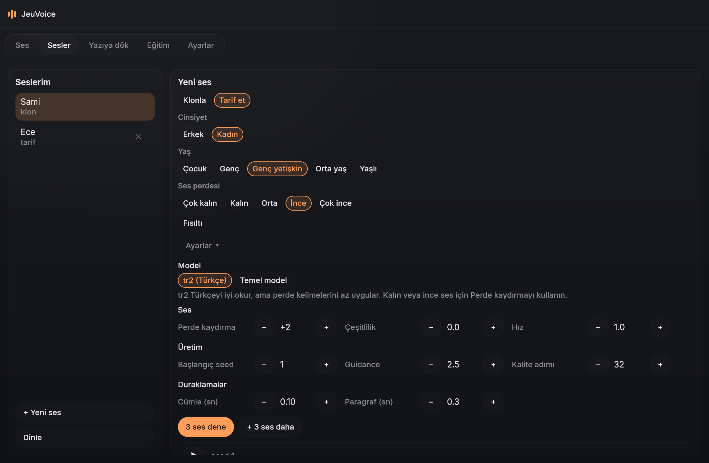

# JeuVoice

JeuVoice is a desktop app for Turkish speech. It does four things in one window:

- **Transcribe**: write down what people say in an audio or video file, with a time for each word.
- **Voice**: read a script aloud in a trained voice, then fix single words or parts.
- **Voices**: make new voices from a short clip or from a description, and save them.
- **Train**: teach the voice model a new voice on Kaggle, without a terminal.

The app is in Rust. The voice engine is a local Python process that runs [OmniVoice](https://huggingface.co/k2-fsa/OmniVoice) with a Turkish LoRA adapter (tr2). The app shows English or Turkish text.





## Status

JeuVoice is an early version (0.0.1). It is tested on Windows 11 with an NVIDIA graphics card.

- The macOS build is not tested. The voice engine does not run on a Mac yet.
- There is no download for the installer yet. Build it from the source (see [Make the installer](#make-the-installer)).
- The tr2 adapter on Hugging Face (`emirbakid/jeuvoice-omnivoice-tr2`) is private at the moment. Without access, use one of these:
  - Type a local checkpoint folder in **Settings → Voice model files**.
  - Make a voice in the **Voices** tab with **Settings → Model → Base model**. The base model (`k2-fsa/OmniVoice`) is public, but it speaks Turkish less well.

## What you need

| Part | Need |
|---|---|
| System | Windows 10 or 11, 64-bit |
| Graphics card | NVIDIA with CUDA for the voice engine. 4 GB of video memory works (tested on an RTX 3050 Ti Laptop GPU). Transcribe also runs on the CPU, but slower. |
| Disk | 8 GB of free space for the voice engine and the models |
| Network | An internet connection on the first start (the engine setup takes 10 to 15 minutes) |
| Training | A Kaggle account with free GPU time. The app sends the data and the notebook to Kaggle. |

## Features

### Transcribe

- Drop many audio or video files (`.mp4`, `.ogg`, `.wav`, `.mp3` and more). The app needs no ffmpeg.
- The app uses Whisper `large-v3-turbo` (about 1.6 GB, downloaded on the first use).
- Each word has a start and end time. Click a word to play from it. Double-click a word to fix it.
- Paste or open a script. The app marks the words that are missing, added or changed.
- Export SRT, VTT or plain text.

### Voice

- Pick a voice, paste a script and click **Generate**. The engine reads one paragraph at a time.
- Drag over a part of the wave and click **Retake region** to get three new takes.
- Double-click a word and type how it must sound (**Say it as**).
- Undo and redo every change. The app saves the project after each change in `Documents/JeuVoice`.
- Export WAV (24 kHz) and SRT.

### Voices

- **Clone**: drop a clip of 3 to 10 seconds. Whisper writes its text, and you check it.
- **Describe**: pick the gender, age and pitch. Try three voices, listen, pick one, and try more.
- **Settings**: model (tr2 or base), pitch shift in semitones, variety, speed, seed, guidance, quality steps and pauses.
- **Sami** is the built-in voice. You cannot delete it.

### Train

- Add clips by drop or from a Hugging Face dataset. Check the text of each clip.
- Start a LoRA run on Kaggle. The app shows the progress, the loss and the checkpoints.
- Test a checkpoint with a fixed sentence. Use the best one in the Voice tab.

For step-by-step help, read the [user guide](docs/user-guide.md).

## Measured speed

Measured on Windows with an NVIDIA RTX 3050 Ti Laptop GPU (4 GB) and the release build.

| Task | Result |
|---|---|
| Transcribe 69 s of Turkish speech (3 files) | 4.3 s, about 16 minutes of sound for each minute of work |
| Start the engine and load the voice model | 25.5 s, 2.4 GB of video memory |
| Read 2 paragraphs aloud (5.6 s of sound) | 12.1 s |
| Kaggle training on 2 × T4 | about 1 hour for each 1,000 steps |

## Build from the source

### Before you start

Install these:

1. [Rust](https://rustup.rs/) (stable).
2. Visual Studio 2022 with the **Desktop development with C++** workload.
3. The [CUDA toolkit](https://developer.nvidia.com/cuda-downloads) and [CMake](https://cmake.org/).
4. LLVM (`libclang`), for `bindgen`.
5. [uv](https://docs.astral.sh/uv/), only to work on the Python engine.

### Build and run

Use `scripts\cargo.cmd` in place of `cargo`. The script sets the Visual Studio, CMake and CUDA settings that `whisper-rs` needs.

```
scripts\cargo.cmd build --release -p jeuvoice-app
```

```
target\release\jeuvoice-app.exe
```

The first release build takes about 11 minutes. The script builds CUDA code for Turing, Ampere and Ada cards (`CMAKE_CUDA_ARCHITECTURES=75;86;89`). Set `CMAKE_CUDA_ARCHITECTURES` first to change this.

On the first start, the app installs the voice engine (Python and the locked packages) in `%APPDATA%\Jeu\JeuVoice`.

### Test

```
scripts\cargo.cmd test --workspace
```

To test the Python engine, make its environment once, then run `pytest`:

```
scripts\engine-dev.cmd
```

```
engine\.venv\Scripts\python -m pytest engine/tests -q
```

Some tests need the real models, a GPU or a Kaggle key. They are marked `#[ignore]` (Rust) or `gpu` (Python), and a normal test run skips them.

### Make the installer

```
scripts\make-installer.cmd
```

This makes `dist\windows\jeuvoice-app_<version>_x64-setup.exe`. The installer installs for one user and needs no admin rights. For signing and the macOS `.dmg`, read [packaging/windows/README.md](packaging/windows/README.md) and [packaging/macos/README.md](packaging/macos/README.md).

## Project layout

| Folder | What it holds |
|---|---|
| `crates/jeuvoice-app` | The desktop app: the tabs, the state and the views |
| `crates/jeuvoice-core` | Audio decode, transcripts, presets, projects and the Kaggle bundle |
| `crates/jeuvoice-whisper` | Whisper speech-to-text (whisper.cpp with CUDA) |
| `crates/jeuvoice-engine-client` | The HTTP client for the voice engine, and the engine process |
| `crates/jeuvoice-kaggle` | The Kaggle API client (datasets, notebooks, outputs) |
| `engine` | The Python voice engine: OmniVoice, the render jobs and the data preparation |
| `assets/presets` | The built-in voice Sami |
| `packaging`, `scripts` | The installers and the build scripts |
| `docs` | The [user guide](docs/user-guide.md), the [design](docs/design.md) and the [development log](docs/development-log.md) |

## License

Apache-2.0. See [LICENSE](LICENSE).
